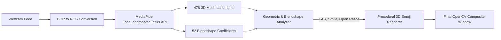

# 🎭 Face-Emoji: Real-Time Living Emoji Avatar

<p align="center">
  
  
  
  
  
  
</p>

An interactive, ultra-low latency computer vision application that tracks your facial landmarks and expressions in real time, transforming your face into a **living 3D glossy emoji avatar**. 

Unlike simple static sticker overlays, **Face-Emoji** mimics your actual facial movements: it smiles when you smile, opens its mouth and shows a tongue when you talk or open your mouth, winks or blinks with your eyes, arches its eyebrows, and blushes automatically.

---

## 📑 Table of Contents

- [✨ Key Features](#-key-features)
- [🧠 How It Works](#-how-it-works)
- [📐 Expression Detection & Mathematical Logic](#-expression-detection--mathematical-logic)
- [📂 Project Structure](#-project-structure)
- [⚙️ Prerequisites](#️-prerequisites)
- [🚀 Installation & Setup](#-installation--setup)
- [🎮 Usage & Controls](#-usage--controls)
- [🔧 Customization Guide](#-customization-guide)
- [❓ Troubleshooting](#-troubleshooting)
- [📜 License](#-license)

---

## ✨ Key Features

- **Living 3D Glossy Emoji Head**: Renders multi-layered concentric spheres with specular catchlight highlights, creating the signature glossy 3D look of Apple and Google emojis directly over your face.
- **Independent Eye Blinking & Winking**: Individually tracks left and right eyes. Winking with one eye renders a playful happy closed arc (`^`) while the other eye stays open with pupils and light reflections.
- **Dynamic Mouth & Speech Tracking**:
  - **Talking / Yawning / Surprise**: Opens dynamically with an inner mouth cavity and red tongue.
  - **Smiling**: Curves mouth corners upward, showing a clean white teeth bar.
  - **Neutral**: Calms down to a gentle resting mouth line.
- **Automatic Rosy Cheeks**: Detects smile intensity and seamlessly overlays soft blushing pink cheeks.
- **Dynamic Eyebrow Response**: Eyebrows arch and adapt based on mouth movements and smile curvature.
- **Powered by Modern MediaPipe Tasks API**: Built with Google's latest `FaceLandmarker` architecture with 52 blendshapes and 478 3D landmarks for sub-millimeter precision.
- **Auto Model Management**: Automatically downloads Google's `face_landmarker.task` on first startup—no manual asset placement needed.

---

## 🧠 How It Works

The processing pipeline operates at high frame rates (30–60 FPS) with low CPU overhead:



1. **Video Capture**: Captures webcam frames using OpenCV and flips them horizontally for a natural mirror experience.
2. **Landmark Inference**: Feeds RGB frames into Google's `FaceLandmarker` with XNNPACK acceleration.
3. **Expression Analysis**: Calculates Eye Aspect Ratio (EAR), mouth openness, and smile curvature, supplemented by MediaPipe blendshapes (`eyeBlinkLeft`, `eyeBlinkRight`, `mouthSmile`, `jawOpen`).
4. **Procedural Rendering**: Renders the 3D emoji head, eyes, pupils, eyebrows, teeth, tongue, and cheeks directly onto the frame, scaled dynamically to the user's face position and size.

---

## 📐 Expression Detection & Mathematical Logic

### 1. Eye Blinking & Winking (EAR)

The application calculates the Eye Aspect Ratio for both eyes using landmark distances:

$$\text{EAR} = \frac{\|\mathbf{p}_{\text{top}} - \mathbf{p}_{\text{bottom}}\|}{\|\mathbf{p}_{\text{inner}} - \mathbf{p}_{\text{outer}}\|}$$

- **Left Eye Indices**: Top (159), Bottom (145), Inner (133), Outer (33)
- **Right Eye Indices**: Top (386), Bottom (374), Inner (362), Outer (263)

When $\text{EAR} < 0.20$ or blendshape $\text{eyeBlink} > 0.45$, the eye smoothly shifts into a closed curved arc (`^`).

### 2. Smile & Rosy Blush Detection

Smile elevation is computed by measuring the vertical displacement between the mouth corners and the bottom lip center relative to the total face height:

Smile Ratio = (Lip_Bottom_Y - ((Lip_Left_Y + Lip_Right_Y) / 2)) / Face_Height

- When smiling is detected ($\text{Ratio} > 0.04$ or $\text{Blendshape} > 0.40$), soft pink blush circles are blended onto the cheeks using `cv2.addWeighted`, and the mouth displays a broad smile showing upper teeth.

### 3. Mouth Openness & Talking

Mouth Open Ratio = Distance(Lip_Top, Lip_Bottom) / Distance(Lip_Left, Lip_Right)

- Indices: Top Lip (13), Bottom Lip (14), Corners (61, 291).
- When open ($\text{Ratio} > 0.35$ or $\text{jawOpen} > 0.35$), the mouth scales into an open ellipse with a nested red tongue.

---

## 📂 Project Structure

```
Face-Emoji/
├── venv/                   # Python Virtual Environment
├── emojis/                 # High-resolution vector emoji assets (for static fallback)
│   ├── happy.png
│   ├── sad.png
│   ├── angry.png
│   ├── surprise.png
│   └── neutral.png
├── app.py                  # Main real-time application script
├── requirements.txt        # Python package dependencies
├── face_landmarker.task    # MediaPipe pretrained vision model (auto-downloaded)
├── .gitignore              # Git ignore rules
└── README.md               # Project documentation
```

---

## ⚙️ Prerequisites

- **Python**: Version `3.10` to `3.14`
- **Webcam**: Any built-in or USB webcam
- **Operating System**: Windows 10/11, macOS, or Linux

---

## 🚀 Installation & Setup

### 1. Clone or Open the Repository

```bash
cd d:\DDON\Face-Emoji
```

### 2. Activate the Virtual Environment

**Windows (PowerShell):**
```powershell
.\venv\Scripts\Activate.ps1
```

> *If you encounter a script execution policy restriction in PowerShell, run:*
> ```powershell
> Set-ExecutionPolicy -ExecutionPolicy RemoteSigned -Scope CurrentUser
> ```

**Windows (Command Prompt):**
```cmd
.\venv\Scripts\activate.bat
```

**macOS / Linux:**
```bash
source venv/bin/activate
```

### 3. Install Dependencies

Ensure your pip packages are installed:

```bash
pip install -r requirements.txt
```

---

## 🎮 Usage & Controls

Run the application:

```bash
python app.py
```

*(On first run, the script will automatically download `face_landmarker.task` ~3.7 MB if not already cached).*

### Keyboard Controls

| Key | Action |
|:---:|:---|
| **`q`** | Gracefully quit the application and release the webcam feed |

---

## 🔧 Customization Guide

You can easily adjust styling and sensitivity in [`app.py`](file:///d:/DDON/Face-Emoji/app.py):

- **Emoji Head Size**:
  In `draw_emoji_face()`, adjust the scale factor:
  ```python
  radius = int(max(face_height, face_width) * 0.58)  # Increase to 0.65 for a bigger head
  ```

- **Blink Sensitivity**:
  ```python
  is_left_blink = (left_ear < 0.20) or (left_blink > 0.45)  # Adjust threshold (e.g. 0.18)
  ```

- **Base Emoji Color Scheme**:
  ```python
  cv2.circle(frame, (cx, cy), radius, (30, 195, 255), -1)  # Classic Emoji Gold (BGR)
  ```

---

## ❓ Troubleshooting

| Issue | Cause | Solution |
|---|---|---|
| `AttributeError: module 'mediapipe' has no attribute 'solutions'` | Older code using deprecated MediaPipe API | Use the current [`app.py`](file:///d:/DDON/Face-Emoji/app.py) which implements the modern MediaPipe `Tasks` API. |
| `Error: Could not open webcam.` | Camera is in use by another app or index is incorrect | Ensure Zoom/Teams/Browser isn't using the webcam. In `app.py`, try changing `cv2.VideoCapture(0)` to `1` or `2`. |
| PowerShell script activation error | PowerShell execution policy restricted | Run: `Set-ExecutionPolicy -Scope CurrentUser RemoteSigned` then re-run `.\venv\Scripts\Activate.ps1`. |
| Low Frame Rate | Hardware bottleneck or high resolution capture | Set camera resolution explicitly: `cap.set(cv2.CAP_PROP_FRAME_WIDTH, 640)` and `cap.set(cv2.CAP_PROP_FRAME_HEIGHT, 480)`. |

---

## 📜 License

Distributed under the [MIT License](https://opensource.org/licenses/MIT). Free for personal, academic, and commercial use.
